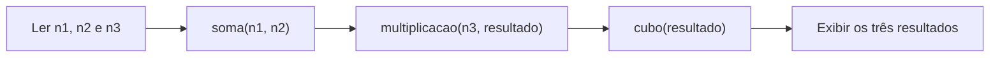

# Programa 1 · Funções e cálculos encadeados

 

[← Conteúdo P1](../README.md) · [↑ Índice geral](../../README.md) · [Ver código-fonte](programa-1.cpp)

## Visão geral

Exercício em C, salvo como `.cpp`, para treinar **entrada de dados, protótipos de funções, retorno de valores e encadeamento de operações**. O programa solicita três inteiros e executa as funções `soma`, `multiplicacao` e `cubo` em sequência.

## Fluxo do algoritmo



| Etapa | Expressão implementada | Função |
|---|---|---|
| 1 | `n1 + n2 + 10` | `soma` |
| 2 | `(n3 + resultado1) * 3` | `multiplicacao` |
| 3 | `resultado2 * resultado2 * resultado2` | `cubo` |

**Exemplo:** para `1`, `2` e `3`, os resultados são `13`, `48` e `110592`.

## Executar

No terminal, a partir da raiz do repositório, com `g++` instalado:

```bash
g++ CONTEUDO_P1/programa-1/programa-1.cpp -o programa1
./programa1
```

No Windows, execute `programa1.exe` após a compilação. O código utiliza `stdio.h`, `scanf` e `printf`, mesmo tendo extensão `.cpp`.

## Arquivos e limites

| Arquivo | Finalidade |
|---|---|
| [programa-1.cpp](programa-1.cpp) | Implementação completa e função `main`. |

Os cálculos utilizam `int` e não incluem validação explícita da entrada nem proteção contra estouro de inteiro. [Explorar os demais exercícios da P1](../README.md).
