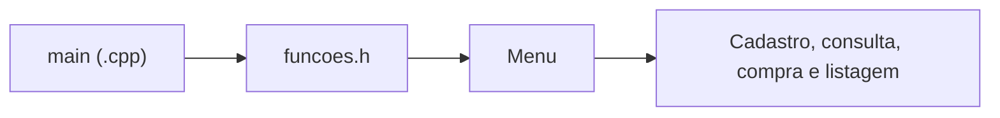

# Programa 3 com biblioteca · Estoque modularizado

 

[← Conteúdo P1](../README.md) · [Versão sem cabeçalho](../programa-3/README.md) · [↑ Índice geral](../../README.md)

## 🎮 Desafio · Diagnóstico de modularização

> **Objetivo:** A missão aqui é identificar e explicar um problema real de compilação, em vez de assumir que o exercício já funciona. XP são **pontos simbólicos de estudo**, não coletados pelo programa.

| Fase | Experimento | Fonte / evidência | XP |
|---|---|---|--:|
| Inspecionar | Encontrar o arquivo principal e o cabeçalho | [`main`](programa-3-com-biblioteca.cpp) | 10 |
| Investigar | Verificar chamadas a funções antes das declarações | [`funcoes.h`](funcoes.h) | 20 |
| Planejar | Descrever como protótipos corrigiriam a organização | [Código modular](funcoes.h) | 30 |

**Checkpoints de conclusão**

- [ ] Identifiquei o `#include` que traz o cabeçalho.
- [ ] Sei por que a compilação falha com g++.
- [ ] Consigo distinguir protótipo de definição de função.

<details>
<summary><strong>✨ Desbloquear desafio extra</strong></summary>

Challenge de melhoria (a implementar): declarar os protótipos necessários e recompilar, conferindo os demais erros eventualmente emitidos.

</details>

**Fidelidade ao código:** O código atual apresenta problemas de compilação documentados; este README não atesta execução bem-sucedida.

---


## Proposta

Variação do cadastro de produtos que separa as funções no arquivo de cabeçalho [`funcoes.h`](funcoes.h), enquanto [`programa-3-com-biblioteca.cpp`](programa-3-com-biblioteca.cpp) contém a função `main`. O foco é estudar a organização de código e a reutilização de rotinas.

| Arquivo | Responsabilidade |
|---|---|
| [programa-3-com-biblioteca.cpp](programa-3-com-biblioteca.cpp) | Inclui o cabeçalho, chama `Menu` e controla o laço principal. |
| [funcoes.h](funcoes.h) | Funções e variáveis utilizadas pelo cadastro, consulta e compra. |
| [programa-3-com-biblioteca.exe](programa-3-com-biblioteca.exe) | Executável Windows incluído no repositório. |

## Fluxo



## Compilação e estado conhecido

Na raiz do repositório, o comando de estudo é:

```bash
g++ CONTEUDO_P1/programa-3-biblioteca/programa-3-com-biblioteca.cpp -o estoque-modular
```

**Atenção:** o código atual apresenta erros de compilação no `g++` porque algumas funções são utilizadas antes de serem declaradas em `funcoes.h`. O comando acima serve para reproduzir e investigar o problema, **não** representa uma compilação validada.

Uma melhoria futura seria adicionar protótipos antes das chamadas e separar declarações (`.h`) de implementações (`.cpp`). Esta documentação não altera o código-fonte.
