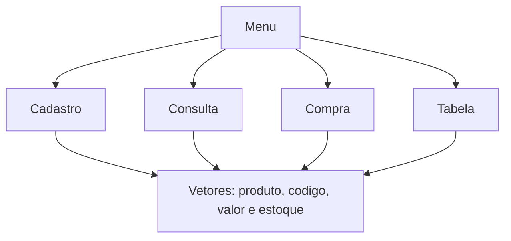

# Programa 3 · Controle de estoque em memória

 

[← Conteúdo P1](../README.md) · [↑ Índice geral](../../README.md) · [Código-fonte](programa-3.cpp)

## O projeto

Aplicação de terminal voltada ao cadastro de até **3 produtos** e à simulação de consulta e compra. É um exercício de **vetores paralelos, funções, validações e passagem de dados por parâmetros**.

| Recurso | O que faz | Estrutura no código |
|---|---|---|
| Cadastrar | Registra nome, código, preço e estoque. | `Cprodutos`, `Ccodigo`, `Cvalor`, `Cestoque` |
| Consultar | Localiza um produto pelo código. | `consulta` |
| Comprar | Solicita produtos e quantidades e calcula o total. | `compra` |
| Exibir | Imprime a tabela de produtos. | `ExibirTabela`, `Pprodutos` |
| Sair | Encerra pelo menu. | `encerrar` |

## Estrutura dos dados



Os quatro vetores compartilham o **mesmo índice**, que identifica cada produto. Os dados não são gravados em banco de dados ou arquivo; são perdidos após o encerramento.

## Compilação

Na raiz do repositório:

```bash
g++ CONTEUDO_P1/programa-3/programa-3.cpp -o estoque
./estoque
```

No Windows, execute `estoque.exe` após compilar.

## Arquivos

| Arquivo/pasta | Papel |
|---|---|
| [programa-3.cpp](programa-3.cpp) | Código principal e rotinas do sistema. |
| [programa-3.exe](programa-3.exe) | Executável incluído para Windows. |
| [output/](output/README.md) | Pasta com executável adicional. |

> Projeto didático: capacidade fixa de três registros e armazenamento temporário. Para estudar modularização, veja a [variação com cabeçalho](../programa-3-biblioteca/README.md).
