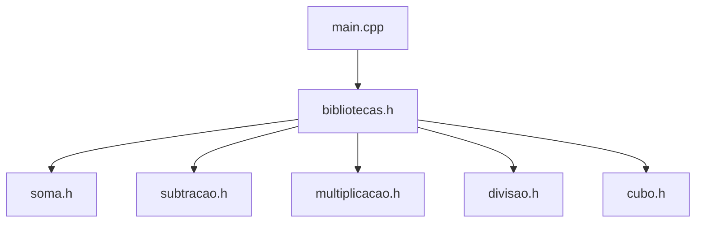

# Programa 5 · Calculadora com funções em cabeçalhos

 

[← Conteúdo P1](../README.md) · [↑ Índice geral](../../README.md)

## Apresentação

Exercício de operações aritméticas com **dois inteiros** digitados no terminal. A função `main` chama cinco rotinas distribuídas em arquivos `.h` e exibe os resultados.

| Operação | Cabeçalho | Expressão |
|---|---|---|
| Soma | [soma.h](soma.h) | `a + b` |
| Subtração | [subtracao.h](subtracao.h) | `a - b` |
| Multiplicação | [multiplicacao.h](multiplicacao.h) | `a * b` |
| Divisão | [divisao.h](divisao.h) | `a / b` (exibida com duas casas decimais) |
| Cubo | [cubo.h](cubo.h) | `(a + b)^3` |

## Organização



Consulte [main.cpp](main.cpp) e [bibliotecas.h](bibliotecas.h) para ver os `#include` usados.

## Como executar

Na raiz do repositório:

```bash
g++ CONTEUDO_P1/programa-5-biblioteca/main.cpp -o calculadora
./calculadora
```

## Limitações e estudo

A função de divisão **não trata divisor igual a zero**. Use um valor diferente de zero em `b`. O exercício ilustra modularização com cabeçalhos; para projetos maiores, é preferível separar declarações nos headers e definições em arquivos-fonte.
