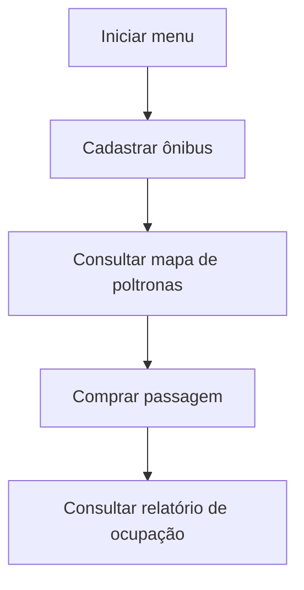

# Programa 6 · Reserva e ocupação de poltronas de ônibus

 

[← Conteúdo P1](../README.md) · [↑ Índice geral](../../README.md) · [Código-fonte](mainBus.cpp)

## 🎮 Missão · Auditoria de poltronas

> **Objetivo:** Interprete a matriz do ônibus e investigue a consistência de suas regras de ocupação. XP são **marcos simbólicos** de aprendizagem e não são calculados pela aplicação.

| Etapa | O que verificar | Evidência | XP |
|---|---|---|--:|
| 01 · Decodificar | Distinguir estados 0, 1, 8 e -1 | [`funcoes.h`](funcoes.h) | 20 |
| 02 · Explorar | Acompanhar fluxo do menu até compra | [`mainBus.cpp`](mainBus.cpp) | 20 |
| 03 · Auditar | Identificar o problema na venda de assentos ocupados | [`funcoes.h`](funcoes.h) | 30 |

**Seu checklist**

- [ ] Consigo explicar a matriz com até 100 linhas e 4 colunas.
- [ ] Reconheci os estados de disponibilidade e ocupação.
- [ ] Sei que a opção 0 não encerra o laço na versão atual.

<details>
<summary><strong>🏅 Desafio bônus</strong></summary>

Em uma branch de estudo, planejar validação para rejeitar estados `8` e `-1` antes de finalizar a compra.

</details>

**Nota técnica:** O desafio de correção não está implementado. Use `Ctrl+C` para interromper o menu existente.

---


## Visão geral

Simulação em terminal para cadastrar ônibus, representar assentos em uma **matriz de 100 linhas × 4 colunas**, vender passagens e consultar a ocupação. O arquivo `mainBus.cpp` cria a matriz e chama `menuPrincipal`, implementada em `funcoes.h`.

## Estrutura

| Arquivo | Utilização |
|---|---|
| [mainBus.cpp](mainBus.cpp) | Entrada da aplicação, variáveis e chamada ao menu. |
| [funcoes.h](funcoes.h) | Cadastro, visualização de poltronas, compra e relatório. |
| [mainBus.exe](mainBus.exe) | Executável Windows presente no projeto. |
| [output/](output/README.md) | Outro artefato compilado do exercício. |

## Legenda da matriz

| Valor | Significado |
|---:|---|
| `0` | Poltrona comum disponível |
| `1` | Poltrona especial disponível |
| `8` | Poltrona vendida |
| `-1` | Posição não cadastrada como assento |



## Compilar e executar

Na raiz do repositório:

```bash
g++ CONTEUDO_P1/programa-6-biblioteca/mainBus.cpp -o onibus
./onibus
```

## Atenção ao comportamento atual

- Cadastre o ônibus antes de consultar lugares ou comprar.
- A implementação permite selecionar assentos já comprados ou posições `-1`; a disponibilidade não é validada completamente.
- A opção `0 - Sair` aparece no menu, mas o código não possui o caso que encerra o laço; use `Ctrl+C` para interromper.

É um **protótipo acadêmico**, sem persistência ou regras completas de uma bilheteria real.
