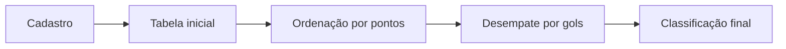

# ⚽ Classificação de times — Pontuação e desempate

[← Conteúdo P2](../README.md) · [↑ Índice geral](../../README.md)

Aplicação de terminal que cadastra **12 times**, recebe nome, gols e pontuação e monta um ranking com dois critérios: **mais pontos** e, em caso de empate, **mais gols**.

## 🧮 Critérios de classificação

| Ordem | Critério | Sentido |
|---:|---|---|
| 1 | Pontuação | Decrescente |
| 2 | Gols, se houver empate em pontos | Decrescente |
| — | Pontos e gols iguais | Não há terceiro desempate |



## 📂 Arquitetura

| Arquivo | Responsabilidade |
|---|---|
| [main.cpp](main.cpp) | Vetores e sequência principal de chamadas |
| [bibliotecas.h](bibliotecas.h) | Inclusões e limites de dados |
| [cadastroTimes.h](cadastroTimes.h) | Entrada de dados e tabela inicial |
| [ordenacaoPlacar.h](ordenacaoPlacar.h) | Ordenação por pontos |
| [tabelaOrdenada.h](tabelaOrdenada.h) | Tabela intermediária |
| [desempate.h](desempate.h) | Reordenação dos times empatados |
| [tabelaPontuacaoFinal.h](tabelaPontuacaoFinal.h) | Exibição final |
| [inserir.txt](inserir.txt) | Doze registros de exemplo |
| [output/](output/README.md) | Artefato `.exe` compilado |

Nome, gols e pontos são armazenados em vetores paralelos. As trocas mantêm os dados do mesmo time associados. Os nomes ocupam vetores de 50 posições, incluindo o terminador da string.

## ⚙️ Compilar e executar

Na raiz do repositório:

```bash
g++ CONTEUDO_P2/Exercicio_tabelaPontuacao/main.cpp -o tabela-times
./tabela-times
```

Para usar os registros de exemplo automaticamente:

```bash
./tabela-times < CONTEUDO_P2/Exercicio_tabelaPontuacao/inserir.txt
```

No Windows, execute o `.exe` produzido pelo compilador.

## ⚠️ Portabilidade e limites

A função de cadastro utiliza `system("pause")` e `system("cls")`, próprios do Windows. Em Linux e macOS esses comandos podem falhar, embora seja possível estudar os algoritmos. Não há um terceiro critério para empates completos nem persistência de registros.
