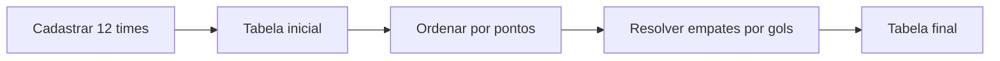

# Classificação de times · Pontuação e critérios de desempate

 

[← Conteúdo P2](../README.md) · [↑ Índice geral](../../README.md) · [Dados de teste](inserir.txt)

## Objetivo

Programa acadêmico que **cadastra 12 times**, registra gols e pontos, exibe os dados de entrada e gera uma classificação em ordem decrescente. A ordenação considera **pontuação primeiro** e **gols como desempate**.

## Regras aplicadas

| Prioridade | Critério | Ordenação |
|---:|---|---|
| 1 | Pontuação | Maior para menor |
| 2 | Quantidade de gols, quando a pontuação empata | Maior para menor |
| — | Pontuação e gols iguais | Não há um terceiro critério |



## Arquitetura por arquivos

| Arquivo | Responsabilidade |
|---|---|
| [main.cpp](main.cpp) | Declara vetores e executa o fluxo. |
| [bibliotecas.h](bibliotecas.h) | Bibliotecas, tamanhos e constantes. |
| [cadastroTimes.h](cadastroTimes.h) | Leitura de nomes, gols e pontos. |
| [ordenacaoPlacar.h](ordenacaoPlacar.h) | Classificação por pontos. |
| [tabelaOrdenada.h](tabelaOrdenada.h) | Exibição intermediária. |
| [desempate.h](desempate.h) | Reordenação por gols entre times empatados. |
| [tabelaPontuacaoFinal.h](tabelaPontuacaoFinal.h) | Exibição da classificação final. |
| [inserir.txt](inserir.txt) | Entrada de exemplo para os 12 times. |
| [output/](output/README.md) | Binário compilado existente. |

Os nomes são mantidos em vetores de 50 posições (incluindo o terminador `\0`).

## Compilar e testar

A partir da raiz do repositório:

```bash
g++ CONTEUDO_P2/Exercicio_tabelaPontuacao/main.cpp -o tabela-times
./tabela-times < CONTEUDO_P2/Exercicio_tabelaPontuacao/inserir.txt
```

Remova o redirecionamento `< .../inserir.txt` para digitar os registros manualmente.

## Compatibilidade e limites

O cabeçalho de cadastro chama `system("pause")` e `system("cls")`, comandos de **Windows**. Em Linux, esses comandos podem falhar, embora a lógica de classificação continue sendo estudável. Não há validação avançada dos valores nem terceiro critério de desempate. Todos os dados são mantidos em memória durante a execução.
