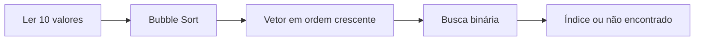

# 🔎 Conteúdo P2 — Strings, ordenação e busca

[← Índice geral](../README.md) · [← Conteúdo P1](../CONTEUDO_P1/README.md)

Reúne exercícios de **manipulação de caracteres, ordenação de vetores, busca binária e classificação de equipes** usando pontuação e gols.

## 📂 Exercícios

| Código | Tema | Resultado principal |
|---|---|---|
| [Exercicio_01.cpp](Exercicio_01.cpp) | Strings e caracteres | Transforma uma frase e apresenta contagens. |
| [Exercicio_02.cpp](Exercicio_02.cpp) | Bubble Sort e busca binária | Ordena dez inteiros e informa o índice encontrado. |
| [Tabela de times](Exercicio_tabelaPontuacao/README.md) | Vetores paralelos e desempate | Classifica doze times por pontos e gols. |

## 📝 Exercício 1 — Texto

O código lê uma frase, converte para maiúsculas, conta caracteres/vogais/consoantes, concatena ` CHUVANAO`, substitui algumas letras e aplica alterações aos códigos dos caracteres.

**Atenção:** a função `qtdPalavasTotal` exibe “Quantidade de palavras”, mas conta caracteres. O vetor tem 100 posições, e a concatenação com `strcat` não verifica o espaço restante. Evite entradas próximas do limite.

## 🔢 Exercício 2 — Busca sobre dados ordenados

O programa lê dez inteiros, imprime o vetor inicial, ordena em ordem crescente usando **Bubble Sort** e solicita um número para procurar por **busca binária**.



Na raiz do repositório:

```bash
g++ CONTEUDO_P2/Exercicio_02.cpp -o busca
./busca
```

Os índices informados começam em zero.

## ⚽ Classificação de times

O projeto solicita **nome, gols e pontos** de doze equipes. Primeiro ordena por pontuação decrescente e depois resolve empates por gols decrescentes.

| Prioridade | Critério |
|---:|---|
| 1 | Maior pontuação |
| 2 | Maior número de gols quando pontos iguais |
| — | Empate completo: não há terceiro critério declarado |

Consulte a [documentação detalhada da tabela](Exercicio_tabelaPontuacao/README.md).

Para utilizar os registros de exemplo:

```bash
g++ CONTEUDO_P2/Exercicio_tabelaPontuacao/main.cpp -o times
./times < CONTEUDO_P2/Exercicio_tabelaPontuacao/inserir.txt
```

O código da tabela chama `system("pause")` e `system("cls")`, próprios do Windows; outros terminais podem acusar comandos inexistentes.
