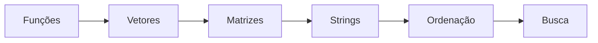

# 🧠 Estrutura de Dados — Exercícios e algoritmos

Coleção acadêmica de programas de terminal organizados por períodos de estudo **P1 e P2**. Os exercícios foram registrados em arquivos `.cpp` e aplicam conceitos de funções, vetores, matrizes, strings, ordenação e busca.

[](https://isocpp.org/) [](https://code.visualstudio.com/)

## 📌 Organização do conteúdo

| Módulo | Temas | Documentação |
|---|---|---|
| **P1** | Funções, parâmetros, vetores, matrizes, cabeçalhos e aplicações de terminal | [CONTEUDO_P1](CONTEUDO_P1/README.md) |
| **P2** | Strings, transformação de texto, Bubble Sort, busca binária e classificação de times | [CONTEUDO_P2](CONTEUDO_P2/README.md) |
| **VS Code** | Tarefas de compilação e depuração | [tasks.json](.vscode/tasks.json) · [launch.json](.vscode/launch.json) |

## 🗺️ Roteiro de aprendizagem



| Projeto | O que demonstra | Guia |
|---|---|---|
| Programa 1 | Funções e operações encadeadas | [Abrir](CONTEUDO_P1/programa-1/README.md) |
| Programa 2 | Tabuadas com laços | [Abrir](CONTEUDO_P1/programa-2/README.md) |
| Programa 3 | Cadastro e compra com vetores | [Abrir](CONTEUDO_P1/programa-3/README.md) |
| Programa 3 modular | Organização do código em cabeçalhos | [Abrir](CONTEUDO_P1/programa-3-biblioteca/README.md) |
| Programa 4 | Variáveis e funções em `.h` | [Abrir](CONTEUDO_P1/programa-4-biblioteca/README.md) |
| Programa 5 | Calculadora modular | [Abrir](CONTEUDO_P1/programa-5-biblioteca/README.md) |
| Programa 6 | Mapa e ocupação de poltronas | [Abrir](CONTEUDO_P1/programa-6-biblioteca/README.md) |
| Exercícios P2 | Caracteres, Bubble Sort e busca binária | [Abrir](CONTEUDO_P2/README.md) |
| Tabela de times | Classificação por pontos e gols | [Abrir](CONTEUDO_P2/Exercicio_tabelaPontuacao/README.md) |

## ⚙️ Compilar e executar

**Requisitos:** compilador `g++` e terminal. Para compilar, por exemplo, o primeiro programa:

```bash
g++ CONTEUDO_P1/programa-1/programa-1.cpp -o programa1
./programa1
```

No Windows, execute `programa1.exe`. Compile **cada exercício separadamente**, porque muitos possuem sua própria função `main()`.

O VS Code contém configurações com caminhos de compilador específicos de Windows/MSYS2, como `c:\tools\msys64\ucrt64\bin`. Esses caminhos dependem da instalação local e precisam ser ajustados conforme o computador.

## 🧪 Exemplos e pontos de atenção

| Caso | Comportamento / limitação verificada |
|---|---|
| [Programa 1](CONTEUDO_P1/programa-1/README.md) | Para entradas `1`, `2`, `3`: resultados `13`, `48`, `110592`. |
| [Programa 3 modular](CONTEUDO_P1/programa-3-biblioteca/README.md) | Uso de funções antes de declarações em cabeçalho provoca erros com `g++`. |
| [Programa 5](CONTEUDO_P1/programa-5-biblioteca/README.md) | Divisão não trata divisor igual a zero. |
| [Programa 6](CONTEUDO_P1/programa-6-biblioteca/README.md) | Algumas seleções de assento não são validadas; saída do menu é incompleta. |
| [Tabela de times](CONTEUDO_P2/Exercicio_tabelaPontuacao/README.md) | Utiliza `pause` e `cls`, comandos próprios do Windows. |

Os arquivos `.exe` são artefatos previamente incluídos no repositório. Prefira compilar os fontes localmente. **Não há suíte de testes automatizados comum a todos os exercícios.**

## 📚 Material de apoio

- [GCC — documentação oficial](https://gcc.gnu.org/onlinedocs/)
- [VS Code — documentação C++](https://code.visualstudio.com/docs/languages/cpp)
- [GitHub — escrita de Markdown](https://docs.github.com/pt/get-started/writing-on-github)
