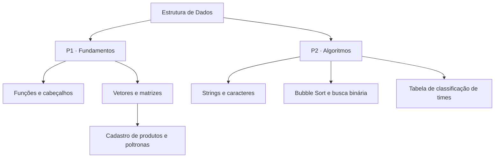

# Estrutura de Dados

 

Coleção de exercícios de programação organizados nas pastas **CONTEUDO_P1** e **CONTEUDO_P2**. Os programas são executados no terminal e abordam funções, ponteiros, vetores, matrizes, strings, ordenação e busca.

## Organização do repositório

| Pasta | Conteúdo | Documentação |
|---|---|---|
| `CONTEUDO_P1` | Operações aritméticas, tabuadas, cadastro de produtos e controle de poltronas | [Guia do conteúdo P1](CONTEUDO_P1/README.md) |
| `CONTEUDO_P2` | Manipulação de frases, ordenação de números, busca binária e classificação de times | [Guia do conteúdo P2](CONTEUDO_P2/README.md) |
| `.vscode` | Configurações de compilação e depuração do VS Code | [Compilação](.vscode/tasks.json) e [depuração](.vscode/launch.json) |

O código dos programas é mantido em arquivos `.cpp`. Nos exemplos organizados em vários arquivos, os cabeçalhos `.h` contêm funções ou declarações utilizadas pelo programa. Cada exercício deve ser compilado separadamente.

## Compilar um exercício

O exemplo abaixo usa `g++` em um terminal Linux. Execute os comandos na raiz do repositório:

```bash
mkdir -p /tmp/estrutura-de-dados
g++ CONTEUDO_P1/programa-1/programa-1.cpp -o /tmp/estrutura-de-dados/programa-1
/tmp/estrutura-de-dados/programa-1
```

O [programa 1](CONTEUDO_P1/programa-1/programa-1.cpp) lê três números inteiros. Para as entradas `1`, `2` e `3`, apresenta:

| Etapa | Cálculo realizado | Resultado |
|---|---|---:|
| 1 | `1 + 2 + 10` | 13 |
| 2 | `(13 + 3) × 3` | 48 |
| 3 | `48³` | 110592 |

Os arquivos `.exe` já existentes são executáveis compilados. Para trabalhar com o código disponível, compile o arquivo-fonte correspondente no seu ambiente.

## Percursos de estudo

- **Funções e cabeçalhos:** compare os programas aritméticos descritos no [conteúdo P1](CONTEUDO_P1/README.md).
- **Vetores e matrizes:** consulte o cadastro de produtos e o exemplo de poltronas no mesmo guia.
- **Strings, ordenação e busca:** avance para os exercícios descritos no [conteúdo P2](CONTEUDO_P2/README.md).

## Observações sobre os arquivos

- [programa-02.cpp](CONTEUDO_P1/programa-2/programa-02.cpp) está vazio.
- A versão [programa-3-biblioteca](CONTEUDO_P1/programa-3-biblioteca/programa-3-com-biblioteca.cpp) usa funções antes de suas declarações e apresenta erros de compilação com `g++`.
- A tabela de times chama `pause` e `cls`, comandos de terminal do Windows. Consulte as orientações no [guia P2](CONTEUDO_P2/README.md).
- As configurações do VS Code usam caminhos locais do Windows, como `c:\tools\msys64\ucrt64\bin`. Confira esses caminhos antes de usar as tarefas de compilação ou depuração.

Os guias internos descrevem os comportamentos e as limitações dos respectivos exercícios.

---

## Mapa de estudos



## Catálogo de exercícios

| Projeto | Conceito central | README detalhado |
|---|---|---|
| Programa 1 | Encadeamento de funções | [Abrir](CONTEUDO_P1/programa-1/README.md) |
| Programa 2 | Tabuadas e laços | [Abrir](CONTEUDO_P1/programa-2/README.md) |
| Programa 3 | Estoque com vetores | [Abrir](CONTEUDO_P1/programa-3/README.md) |
| Programa 3 (biblioteca) | Cabeçalhos e modularização | [Abrir](CONTEUDO_P1/programa-3-biblioteca/README.md) |
| Programa 4 | Variáveis e funções em headers | [Abrir](CONTEUDO_P1/programa-4-biblioteca/README.md) |
| Programa 5 | Calculadora modular | [Abrir](CONTEUDO_P1/programa-5-biblioteca/README.md) |
| Programa 6 | Matriz de poltronas | [Abrir](CONTEUDO_P1/programa-6-biblioteca/README.md) |
| Exercício 1 (P2) | Tratamento de strings | [Guia P2](CONTEUDO_P2/README.md) |
| Exercício 2 (P2) | Ordenação e busca binária | [Guia P2](CONTEUDO_P2/README.md) |
| Tabela de times | Ordenação com desempate | [Abrir](CONTEUDO_P2/Exercicio_tabelaPontuacao/README.md) |

## Ambiente de desenvolvimento

| Item | Orientação |
|---|---|
| Editor | [Visual Studio Code](https://code.visualstudio.com/) ou editor de preferência |
| Compilador | GCC/`g++` compatível com seus arquivos |
| Windows | É possível configurar [MSYS2](https://www.msys2.org/) para obter `g++` |
| Linux | Use uma instalação de GCC/`g++` disponível no sistema |
| Execução | Cada programa tem seu `main` e deve ser compilado separadamente |

**Não há testes automatizados ou um sistema de build único configurado.** As pastas `output` e arquivos `.exe` são artefatos e não substituem os códigos-fonte. Para distinguir limitações de implementação e comportamentos esperados, consulte os guias por projeto.
